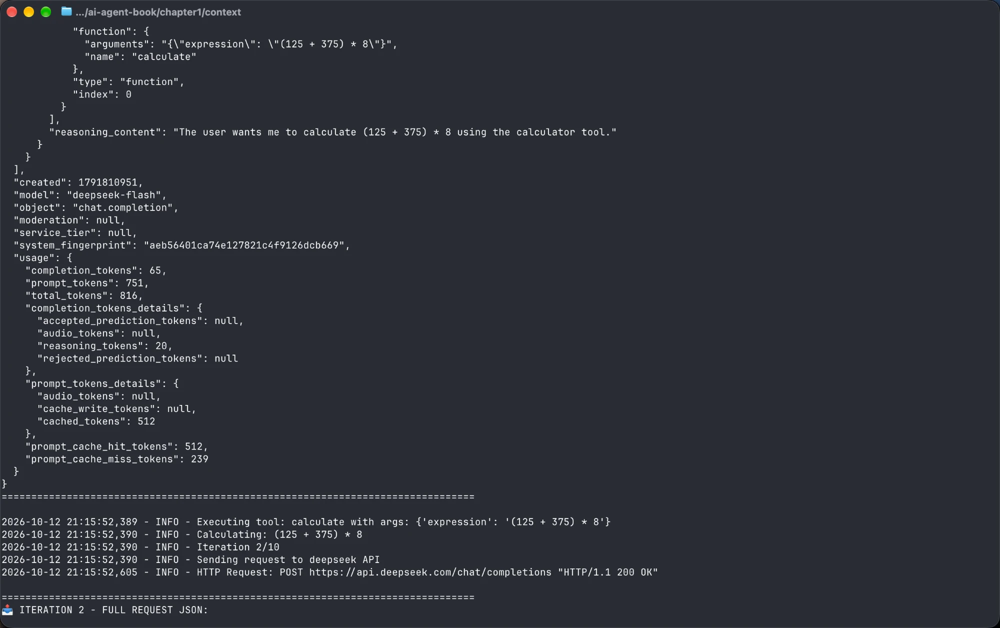

# 《深入理解 AI Agent》读书笔记｜第 1 章 AI Agent 入门

## 1. Agent 的组成：LLM + 上下文 + 工具

## 2. Agent 的运行：ReAct 循环

## 3. Harness 工程：上下文管理 + 工具接口 + 约束 + 验证 + 纠正

## 4. Harness 工程落地的三个决策：选模型、选编排、设护栏

## 5. 全书结构与设计模式

## 环境运行截图

## 我的实验与理解
